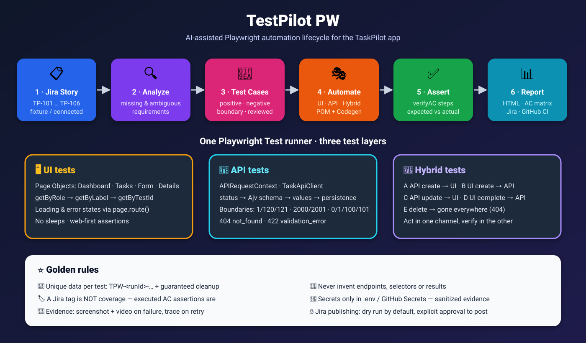

# TestPilot PW

**Enterprise Playwright UI & API automation framework for the TaskPilot application** — built for the
*AI-Assisted Software Engineering* workshop (Project 02).

```
Jira Story → Requirements Analysis → Test Cases → Playwright UI/API/Hybrid → Step Assertions → Evidence → Reports → Jira → GitHub CI
```



## What it tests
| | URL (default) | Notes |
|---|---|---|
| TaskPilot UI | https://taskpilot-web.onrender.com | React + Vite — dashboard, tasks, task details |
| TaskPilot API | https://taskpilot-api-k11v.onrender.com | FastAPI — [`/docs`](https://taskpilot-api-k11v.onrender.com/docs), `/openapi.json` |

The TaskPilot database is **shared**: every test creates uniquely named data (`TPW-<runId>-…`) and deletes it afterwards.

## Quick start
```bash
# Node.js 22+ (24 LTS recommended)
npm ci                              # or: npm install
npx playwright install chromium     # add --with-deps on Linux/CI
cp .env.example .env                # optional — defaults target the hosted TaskPilot
npm run typecheck
npm test                            # API + Chromium (UI, hybrid, codegen)
npm run report                      # open the HTML report
```

## Commands
| Command | Purpose |
|---|---|
| `npm test` | Full suite (projects `api` + `chromium`) |
| `npm run test:api` / `test:ui` / `test:hybrid` | One layer |
| `npm run test:smoke` | `@smoke` tagged tests |
| `npx playwright test --grep @TP-101` | Everything tagged for one story |
| `npm run test:evidence` | Full evidence (screenshots, video, trace for every test) |
| `npm run test:all-browsers` | Adds Firefox + WebKit (install them first: `npx playwright install firefox webkit`) |
| `npm run test:headed` / `test:debug` | Watch / step through in Chromium |
| `npm run demo:create-tasks` | Headed demo: creates 3 **persistent** `TPW-DEMO-*` tasks through the UI |
| `npm run demo:cleanup` | Deletes only `TPW-DEMO-*` tasks |
| `npm run browsers:install` | Install Chromium, Firefox and WebKit |
| `npm run codegen [-- <url>]` | Record a flow with Playwright Codegen |
| `npm run report` | Open Playwright HTML report |
| `npm run jira:read -- TP-101` | Read + normalize + analyze a Jira story |
| `npm run jira:generate -- TP-101` | Draft test cases with AC traceability |
| `npm run jira:publish -- TP-101 [--approve]` | Dry run (default) or approved publishing |
| `npm run jira:sync [-- --approve]` | Sync user stories, linked test cases and evidence to Jira project TAS |

## Project structure
```
testpilot-pw/
├── tests/
│   ├── api/        *.api.spec.ts — health, create, read/list, update, delete, dashboard
│   ├── ui/         dashboard, create, search/filter, edit, details, loading & errors
│   ├── hybrid/     scenarios A–E (UI ⇄ API)
│   └── codegen/    refactored Codegen example
├── pages/          BasePage, DashboardPage, TasksPage, TaskForm, TaskDetails
├── fixtures/       test.ts (custom fixtures), task-factory.ts (data + cleanup)
├── clients/        task-api-client.ts (APIRequestContext)
├── schemas/        Ajv JSON schemas (task, task-list, dashboard-summary, error, health)
├── data/
│   ├── jira/       TP-101 … TP-106 Jira issue fixtures (REST v3 / ADF)
│   └── test-cases/ catalogue.json — approved test cases
├── integrations/jira/  adf, jira-client, story-reader, requirements-analyzer,
│                       test-case-generator, evidence-publisher, cli/
├── reporting/      ac-coverage-reporter.ts, coverage-html.ts
├── utils/          test-data, traceability, evidence, sanitize, schema-validator
├── config/         env.ts, global-setup.ts (health wait), global-teardown.ts (prefix sweep)
├── scripts/        codegen.mjs, with-env.mjs
├── docs/           architecture (8 Mermaid diagrams), strategy, codegen, evidence, Jira, CI, DoD …
├── .cursor/rules/  6 rule files          .cursor/skills/  15 SKILL.md
├── .github/workflows/playwright.yml
├── AGENTS.md  playwright.config.ts  tsconfig.json  package.json  .env.example  .gitignore
```

## Key concepts (for students)
- **One runner, three layers** — UI, API and hybrid tests share config, fixtures, reporters and evidence.
- **Page Object Model** — locators live in `pages/`; specs read like business flows.
- **Fixtures** — `api`, `tasks`, `tasksPage`, `details`, `dashboard` are injected; cleanup is automatic.
- **Traceability** — `trace({ testCase, covers })` declares intent; `verifyAC(ac, step, expected, fn)` proves it.
  The coverage reporter only counts ACs whose assertion steps actually ran.
- **No sleeps** — loading/error states are made deterministic with `page.route()`.
- **Honest reporting** — every number comes from `reports/coverage/ac-coverage.json` of a real run.

## Reports
| Output | Path |
|---|---|
| Playwright HTML | `reports/html/index.html` |
| JUnit XML | `reports/junit/results.xml` |
| JSON results | `reports/json/results.json` |
| AC coverage matrix | `reports/coverage/ac-coverage.{html,md,json}` |
| Execution / failure summary | `reports/coverage/execution-summary.md`, `failure-summary.md` |
| Screenshots, videos, traces | `test-results/` |
| Jira publishing records | `reports/jira/` |

## Documentation
- [Architecture & diagrams](docs/architecture.md) · [Test strategy](docs/test-strategy.md) · [API contract findings](docs/api-contract-findings.md)
- [Codegen workflow](docs/codegen.md) · [Evidence](docs/evidence.md) · [Jira integration](docs/jira-integration.md) · [CI](docs/ci.md)
- [Cursor master prompt & milestones](docs/cursor-master-prompt.md) · [Definition of Done](docs/definition-of-done.md) · [AGENTS.md](AGENTS.md)

## Latest verified execution
See `docs/definition-of-done.md`. Connected Jira mode is verified (project TAS); GitHub Actions execution is **not yet verified**.
