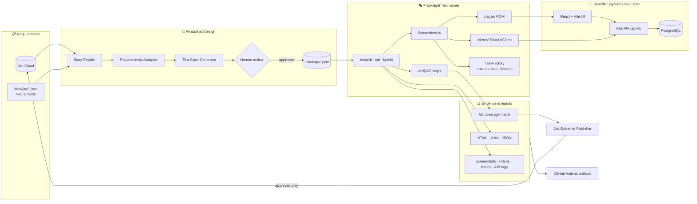
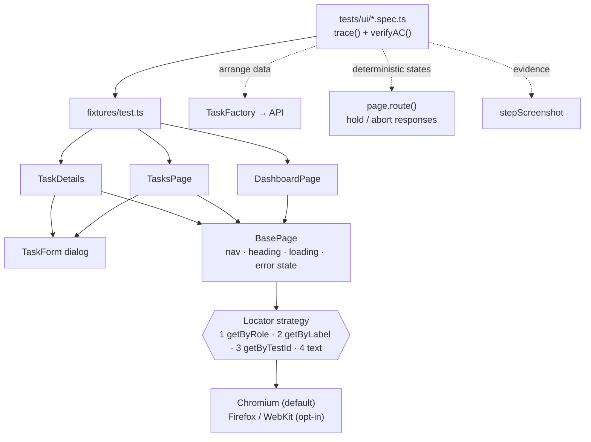
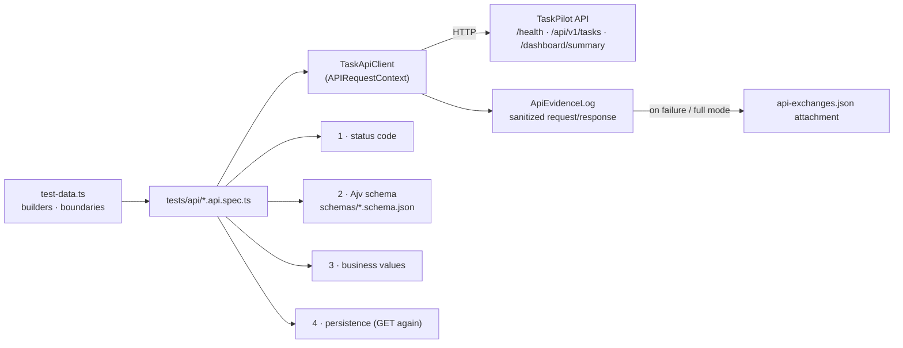
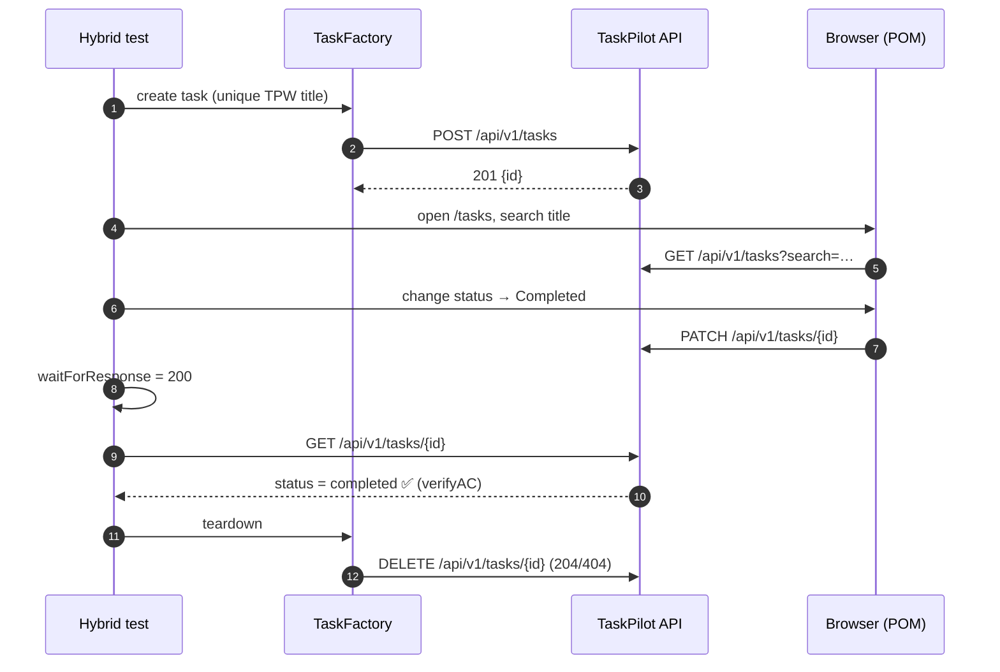
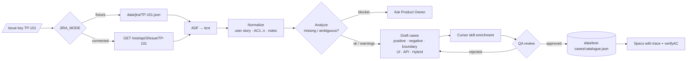
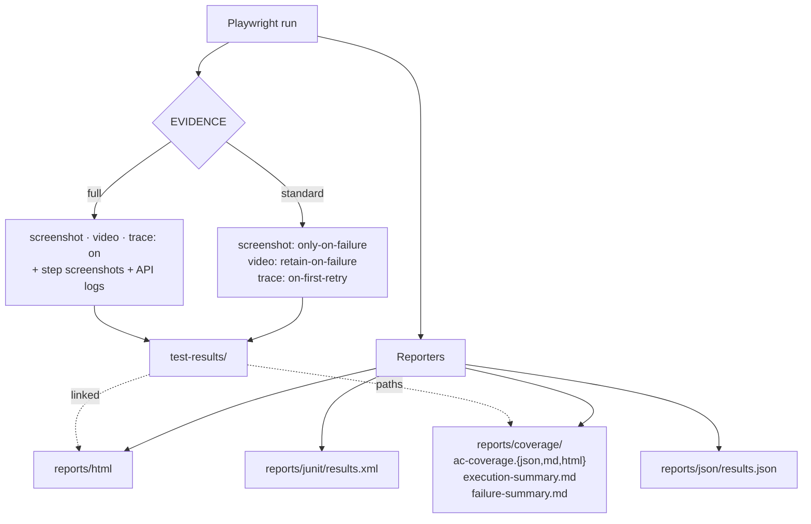
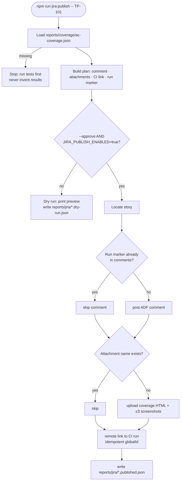
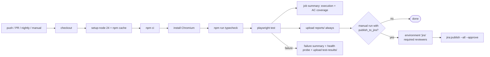

# TestPilot PW — Architecture & Flow Diagrams

All diagrams are Mermaid (render on GitHub, Cursor preview, or https://mermaid.live).
Training infographic: [`diagrams/testpilot-infographic.svg`](diagrams/testpilot-infographic.svg).

## 1. Complete automation architecture

## 2. UI automation architecture

## 3. API automation architecture

## 4. Hybrid test execution

## 5. Jira story → test case generation

## 6. Evidence capture and reporting

## 7. Jira publishing workflow

## 8. GitHub CI execution

